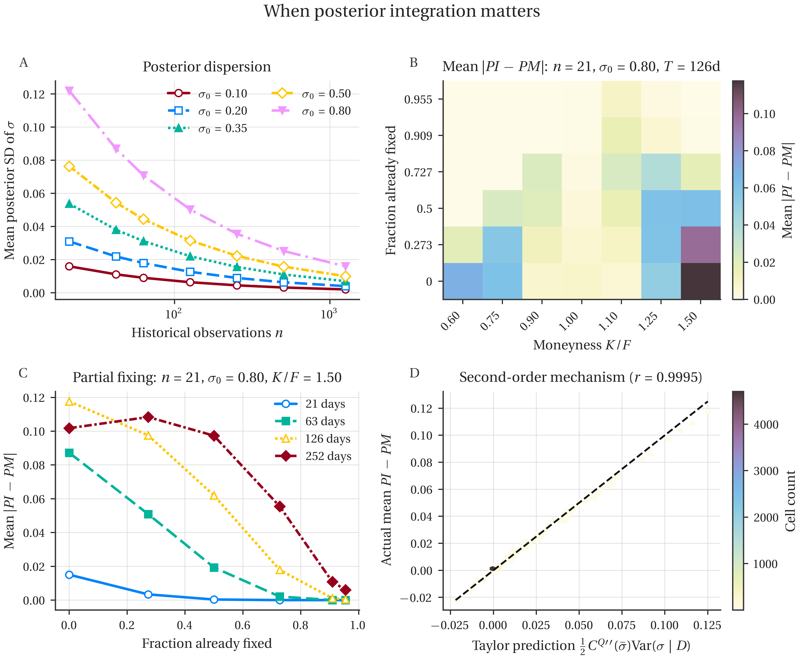

# Posterior Integration and Volatility Inputs in WTI Asian Options

Reproducible research software for the paper **“Posterior Integration and Volatility Inputs in WTI Asian Options.”** This repository separates **Bayesian uncertainty in a volatility parameter** from **the choice of volatility information** used to price WTI Average Price Options (APOs).

This is the **public software and documentation package**. It is deliberately separate from the internal research archive. Market observations purchased or downloaded from Barchart and Databento are **not redistributed here**.

## What question does the paper ask?

An Asian option depends on the average of commodity prices over time. We study two ways to use a Bayesian volatility estimate:

- **Posterior integration (PI):** calculate option values at possible volatility levels and average the values over the posterior.
- **Posterior-mean plug-in (PM):** calculate one option value at the posterior mean volatility.

The distinction is

\[
C_{\mathrm{PI}}=\mathbb E[C^Q(\sigma)\mid\mathcal D],\qquad
C_{\mathrm{PM}}=C^Q(\mathbb E[\sigma\mid\mathcal D]).
\]

Historical inference is performed under the physical measure **P**. Pricing uses separate risk-neutral **Q** dynamics: the estimated physical drift is not inserted into risk-neutral option prices.

The WTI application also asks whether volatility estimates inferred from **earlier option prices** provide better out-of-sample APO valuations than those inferred from historical futures returns.

## Results and limits

The companion paper reports 175,000 simulated return histories, 310 October-2026 APO contract-date observations for posterior-integration comparisons, 2,381 forward-in-time pricing observations, and a 253-observation independent vanilla-WTI option check. These numbers are **reported research outputs**, not results reproduced automatically by installing this repository. The market-data experiments require independently licensed source data; see [data access](docs/market_data_and_reproducibility.md).

The evidence applies to the maintained constant-volatility, one-factor futures-pricing benchmark, not to all commodity option-pricing models. The out-of-sample comparison covers relatively few valuation dates and many settlement marks have little or no corresponding trading volume.

## Run a self-contained pricing comparison

This short example uses **illustrative volatility scenarios**, not a fitted
posterior or exchange prices. It demonstrates the difference between averaging
risk-neutral prices and pricing at the mean volatility:

```bash
python examples/posterior_integration_vs_plugin.py
```

For the simulation design and market-dependent experiments reported in the paper,
use [the experiment map](docs/experiments.md). The market results cannot be
reproduced from this source-only repository without independently licensed data.



*Figure: synthetic experiment, not a chart of proprietary market observations.*

## Repository guide

| Location | Contents |
| --- | --- |
| `src/bayesian_asian_options/` | Reusable pricing, Bayesian inference, simulation, and WTI fixing logic |
| `experiments/` | Named experiment entry points; separate market-dependent runs from synthetic studies |
| `tests/` | Curated mathematical and numerical tests |
| `docs/model_and_assumptions.md` | Model definitions, notation and interpretation |
| `docs/experiments.md` | Where to start for each scientific question |
| `docs/market_data_and_reproducibility.md` | Data access, boundaries, licensed data and validation |
| `supplement/robustness_and_numerical_checks.md` | Candidate research supplement, Sections S1–S4, without archived drafts |
| `figures/synthetic_posterior_integration.png` | Synthetic mechanism figure (no raw exchange quotes) |
| `SOURCE_PROVENANCE.json` | Exact private-source commit and Git blob IDs for transferred files |

## Install

Requires Python 3.11 or later.

```bash
python -m venv .venv
# Windows PowerShell: .venv\Scripts\Activate.ps1
# macOS/Linux: source .venv/bin/activate
python -m pip install -e ".[dev]"
python -m pytest -q tests/test_bayesian_gbm.py tests/test_asian_pricing.py
```

The package imports as `bayesian_asian_options`. For market-data access, install `.[market]` separately. **Installing the package does not download, purchase, or grant rights to market data.** Some empirical entry points require private input files and will not run using this public archive alone.

## Reproducing the research

Start with [the experiment map](docs/experiments.md). Synthetic tests do not require Barchart or Databento, but publication-sized runs can be expensive. WTI APO empirical workflows require your own eligible Barchart/Databento access and explicitly dated CL futures and option histories. Do not substitute continuously rolled futures for the contemporaneous CL term structure without reporting that as a different experiment.

**Citation:** See [`CITATION.cff`](CITATION.cff). The Zenodo DOI will be added **after a verified GitHub release has actually been archived**; no DOI has been assigned to this candidate package yet. A blinded manuscript should not disclose an author-identifying public repository URL unless the journal permits it.

## Licensing

Code ownership and an appropriate open-source license must be confirmed **before publication**. Source code licensing never grants redistribution rights for Barchart, Databento, CME/NYMEX or other third-party market data. Do not upload market CSVs, paid data extracts, exchange-derived row-level panels, API keys, or previous repository history to this public repository.
